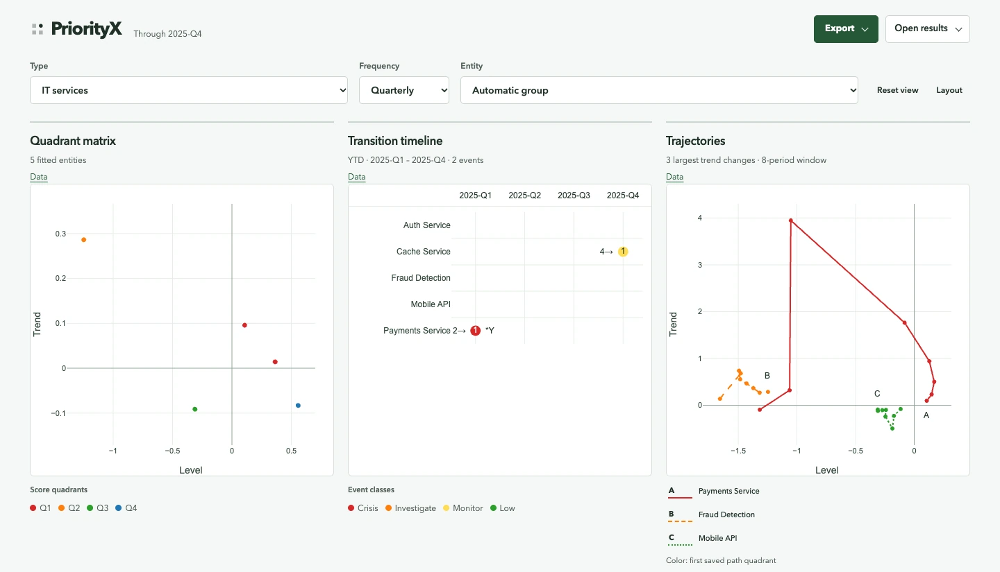

# PriorityX

Prioritize entities and detect escalation using GLMM statistical models.
Use the Python API to analyze event data, and AutoViz to inspect saved results
through linked interactive charts.

## Get started

- [Install PriorityX](installation.md) — Python 3.12+, macOS/Linux and Windows setup.
- [Try AutoViz](autoviz-example.md) — open the saved IT incidents sample without fitting models.
- [Analyze your data](quickstart.md) — fit a matrix, track movement and detect transitions.

## AutoViz

Explore a **quadrant matrix → YTD transition timeline → trajectories** workspace.
Select an entity across charts, read exact values, adjust layouts and export an
interactive view that reopens offline.

See the [workspace guide](app.md) for controls and exports, and the
[saved-result contract](saved-results.md) for bundles, identity/date columns
and CSV mapping.

## Python analysis

PriorityX provides GLMM-based quadrant scores, cumulative movement tracking,
transition detection, driver analysis, custom axes and weighted composite indices.
The [API reference](api-reference.md) covers parameters and outputs;
[methodology](methodology.md) explains the models and
[priority classification](priority_classification.md) explains quadrants and events.

Examples include [IT incidents, software bugs and compliance monitoring](https://github.com/okkymabruri/priorityx/tree/main/examples).
